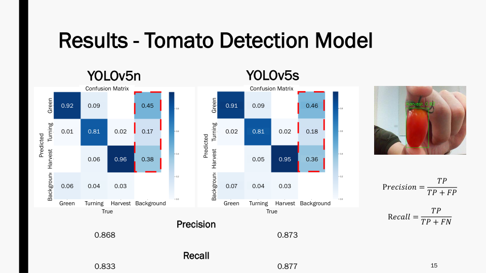
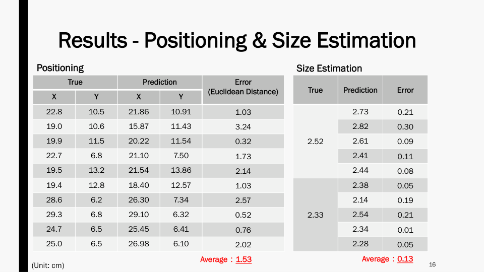
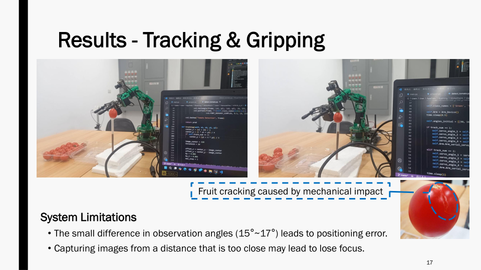

# DOFBOT Automatic Harvesting Gripper

This repository contains the source code for an automated tomato harvesting system using the Yahboom DOFBOT AI Vision Robotic Arm. It integrates deep learning for tomato detection and ripeness classification, stereo vision for localization and size estimation, and inverse kinematics for precise gripping.

## Table of Contents
- [System Environment](#system-environment)
- [Project Architecture](#project-architecture)
- [Methodology](#methodology)
- [Usage](#usage)
- [Results](#results)
- [References](#references)

## System Environment
The project is designed to run on the **Yahboom DOFBOT AI Vision Robotic Arm** (Jetson Nano version) with the following specifications:
- **OS:** Ubuntu 18.04 (JetPack 4.4)
- **Python:** 3.6.9
- **Deep Learning Framework:** PyTorch 1.10.0 / torchvision 0.11.0
- **Hardware Dependencies:** Requires the native `Arm_Lib` provided by Yahboom for servo control.

*Note: Since the system environment is tied to the DOFBOT's Jetson Nano image, a traditional `requirements.txt` is not provided. Please ensure you are running on the compatible Yahboom system image.*

## Project Architecture
- `main.py`: The main orchestrator script. It runs the tracking loops, calls kinematic calculations, estimates size, and executes the harvesting sequence.
- `gripper.py`: Contains the core mathematical models: Forward Kinematics, Triangulation (Positioning), Size Estimation, Inverse Kinematics, and the Gripping regression model.
- `calibration_matrix.npz`: Contains the camera intrinsic parameters (Camera Matrix and Distortion Coefficients) used for size estimation.
- `yolov5/detect_tomato.py`: Contains the YOLOv5 inference script and a PID controller to track and align the camera to the tomato.

## Methodology

### 1. Tomato Detection and Tracking
The system uses a custom-trained **YOLOv5** model (TorchScript format) to classify tomatoes into three stages: Green, Turning, and Harvest. 
Once a tomato is detected, the arm utilizes a Proportional (P) controller to smoothly move the servos and align the camera such that the tomato is perfectly centered in the frame.

### 2. Stereo Vision Positioning (Triangulation)
Since the DOFBOT uses a single monocular camera, the system simulates stereo vision by tracking the tomato from **two different angles**.
- **Forward Kinematics:** Computes the precise 2D position and orientation of the camera at both tracking angles based on the arm's segment lengths and servo angles.
- **Triangulation:** Finds the intersection of the two viewing vectors to calculate the absolute real-world 2D coordinates of the tomato.

### 3. Tomato Size Estimation
Using the **Pinhole Camera Model** and the camera's intrinsic parameters (from `calibration_matrix.npz`), the physical width of the tomato is calculated using the distance obtained from triangulation and the pixel width of the bounding box. This prevents the gripper from crushing the fruit.

### 4. Inverse Kinematics and Gripping
- **Inverse Kinematics:** Computes the exact angles for the DOFBOT's joints (Servos 2, 3, and 4) to reach the calculated tomato coordinates while maintaining a specific grasping angle (phi = 15°-20°) to avoid collisions with branches.
- **Gripping (Polynomial Regression):** A 3rd-degree polynomial regression model maps the estimated physical width of the tomato to the PWM angle of the gripper servo (Servo 6), ensuring a firm but safe grip.

## Results

The performance of the system has been validated in the following aspects:

### 1. Detection Model Performance
The custom YOLOv5s model achieves robust performance for classifying ripeness stages:
- **Precision:** 0.86
- **Recall:** 0.88



### 2. Positioning and Size Estimation Accuracy
- **Stereo Vision Positioning:** Average Euclidean distance error of **1.53 cm**.
- **Tomato Size Estimation:** Average absolute error of **0.13 cm**, which reliably prevents mechanical damage during gripping.



### 3. Tracking and Gripping
The gripper successfully adapts to the estimated size.


*System Limitations:* Small observation angle differences (15°~17°) can lead to slight positioning errors. If the camera captures images too close to the tomato, it may lose focus. Fruit cracking may occasionally occur due to mechanical impact if calibration is off.

## Usage
1. Ensure the DOFBOT is powered on and the environment matches the specifications above.
2. Ensure the pre-trained YOLOv5 weights (`yolov5n_tomato.torchscript`) are located in the `yolov5/weights/` directory.
3. Run the main script:
   ```bash
   python3 main.py
   ```
4. The arm will begin searching and tracking the tomato. Press `q` to manually quit the operation at any time.

## References
- Yahboom DOFBOT AI Vision Robotic Arm
- YOLOv5: [ultralytics/yolov5](https://github.com/ultralytics/yolov5)
- ZJU-lishuang YOLOv5-v4 fork: [ZJU-lishuang/yolov5-v4](https://github.com/ZJU-lishuang/yolov5-v4)
